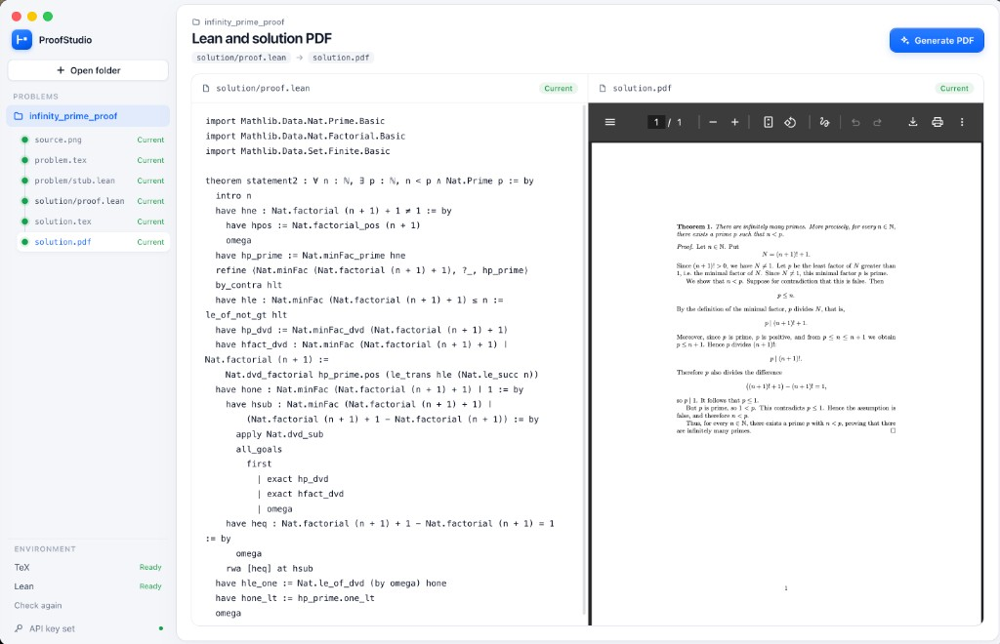

# ProofStudio

ProofStudio is a macOS app for working on a math proof e2e.



You open a folder. The folder name is the problem name. The app keeps the files for that problem inside the folder and shows whether each one is empty, current, stale, or failed. You choose the next step. The app does not run the whole pipeline for you.

The steps are:

1. Add a screenshot and turn it into `problem.tex`. The app compiles it with `pdflatex`. A TeX error stops this step.

2. Turn that statement into `problem/stub.lean`, a Lake project whose proof is `sorry`. Muse writes two statements. A statement that does not compile is asked again. One that compiles is kept, and the next question adds a second statement. Each file is checked with `lake env lean`.

3. Generate `solution/proof.lean` in a separate Lake project. Both projects share one Mathlib build, and the app lists only the two Lean files. The statements are proved at the same time, and the first proof that compiles is kept. Attempts start at 3 and can be set from 1 to 10. A reply that still contains `sorry` is rejected. Earlier Lean errors stay on this step and go with the next attempt.

4. Write `solution.tex` from the Lean proof and compile `solution.pdf`, up to 3 attempts. The PDF opens beside the proof. Select a passage and right-click Lean component to highlight the matching lines.

A Meta Muse API key is entered in the app and kept in memory until you quit. It is not saved to disk.

## Run the app

You need Node.js and npm. PDF generation needs MacTeX, which provides `/Library/TeX/texbin/pdflatex`. The Lean stub needs Lean 4, installed with elan. The first stub also downloads Mathlib for that Lean version. The app still opens without them.

```bash
npm install
npm start
```

`npm start` builds the app and opens it in Electron on this Mac. The window loads those built files. It does not open a browser.

`npm run dev` is for editing. It also opens Electron, and refreshes that window from a local server while files change. macOS calls both of these processes Electron. `npm run app` writes `ProofStudio.app`, which uses the ProofStudio Dock name.

## Generate the app

```bash
npm install
npm run app
open dist/mac-arm64/ProofStudio.app
```

`npm run app` writes `dist/mac-arm64/ProofStudio.app`. The Dock and the menu name are ProofStudio.

`out/` is the compiled JavaScript, not the app. `npm start` and `npm run dev` launch Electron's own shell, so macOS calls that process Electron.

## Generate a DMG

```bash
npm run dmg
open dist/ProofStudio-0.1.0-arm64.dmg
```

`npm run dmg` writes `dist/ProofStudio-0.1.0-arm64.dmg`. The version in the file name comes from `package.json`. Opening the disk image shows `ProofStudio.app`, which you can drag into Applications.

## Changes

Do not commit directly to `main`. Open a pull request for each change.
